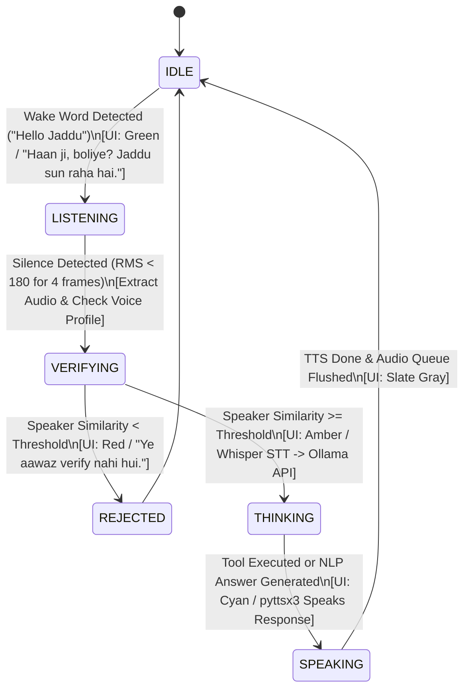
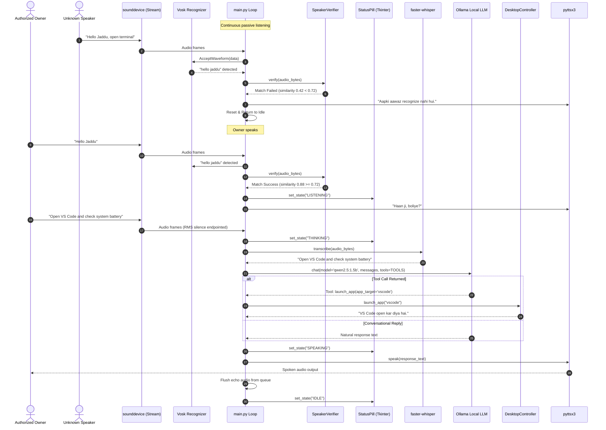

# Project Specification & Master Cline Prompt: Jaddu Voice Assistant

---

## 1. Product Requirements Document (PRD)

### 1.1 Executive Summary
**Jaddu** is a personal, 100% offline, privacy-first desktop voice assistant for Windows. It is secured by **Speaker Voice Verification (Voice Biometrics)**, ensuring that it responds exclusively to its owner's voice. Jaddu is powered locally by **Ollama** for reasoning and tool calling, **Vosk** for low-latency wake-word spotting ("Hello Jaddu"), **faster-whisper** for speech-to-text, **pyttsx3** for offline vocal feedback, and a desktop automation suite that executes desktop, media, window, hardware, or shell commands on demand.

### 1.2 Target User & Personas
- **The Owner (Exclusive Primary User):** Requires a dedicated voice assistant that executes personal OS tasks, opens applications, controls media, runs terminal scripts, and reports system health without triggering for family, colleagues, or background chatter.
- **Privacy & Security Purist:** Demands 100% on-device local execution (via Ollama, Vosk, Whisper, and local voice embeddings) with zero cloud dependencies.

### 1.3 Key Features & Functional Requirements (FR)
- **FR-1: Wake-Word Detection ("Hello Jaddu"):** Listens continuously in low-power idle mode via Vosk (`vosk-model-small-en-in-0.4`) recognizing "Hello Jaddu" and phonetic variants ("hey jaddu", "jaddu", "jadu").
- **FR-2: Speaker Voice Recognition & Authentication (Owner Voice Only):**
  - **Voice Enrollment (`enroll_voice.py`):** One-time setup script recording 3 to 5 samples of the owner's voice, extracting acoustic speaker embeddings (via `resemblyzer` or `speechbrain`/ECAPA-TDNN), and persisting an enrolled profile (`voice_profile.npy`).
  - **Live Voice Verification:** Before executing any command, the audio segment is evaluated against `voice_profile.npy` using Cosine Similarity. If similarity < threshold (e.g., 0.72), the query is rejected or silently discarded ("Aapki aawaz verify nahi hui").
- **FR-3: Dynamic VAD & Command Audio Capture:** RMS energy thresholding (~180.0 RMS) with dynamic silence windowing (~1s pause) to isolate user commands.
- **FR-4: High-Accuracy Offline STT:** Transcription via `faster-whisper` (`base.en` or multilingual model, CPU int8 quantization).
- **FR-5: Local LLM Brain via Ollama:**
  - Connects to local Ollama daemon (`http://localhost:11434`) using `qwen2.5:1.5b`, `llama3.2:1b`, or `llama3.2:3b`.
  - Executes function calling using Ollama's native tool-calling API.
  - Persona: "Jaddu" — friendly, proactive, concise, speaking in natural Hinglish/English.
- **FR-6: Universal Desktop Automation Suite:**
  - **Application Launcher:** Opens apps (VS Code, Chrome, Brave, Terminal, Notepad, Calculator, Spotify, Discord, Explorer, Task Manager).
  - **Web Browsing & Search:** Instant domain resolution and Google queries.
  - **Media & Sound Control:** Volume up/down, mute toggle, play/pause, track next/previous.
  - **Window Management:** Close (`Alt+F4`), minimize (`Win+Down`), maximize (`Win+Up`), switch (`Alt+Tab`), show desktop (`Win+D`), lock workstation (`rundll32`).
  - **System Status Diagnostics:** Live CPU %, RAM %, Disk %, and Battery charging state via `psutil`.
  - **Instant Screenshots:** Desktop screenshot capture utility.
  - **Shell Command Runner:** Executes arbitrary terminal/PowerShell commands with blacklist protection against destructive commands (`rmdir /s`, `format`, `del /f`).
  - **Workflow Presets (Macros):** Multi-step macros for "coding mode", "break mode", "wrap up".
- **FR-7: Draggable Floating HUD Overlay:** Borderless, translucent Tkinter status pill displaying real-time states:
  - `IDLE` (Slate Gray)
  - `LISTENING` (Emerald Green)
  - `VERIFYING` / `THINKING` (Amber)
  - `SPEAKING` (Neon Cyan)
- **FR-8: Offline Vocal Feedback (TTS):** SAPI5 speech synthesis via `pyttsx3`.

---

## 2. Technical Requirements Document (TRD)

### 2.1 Technology Stack
| Subsystem | Technology | Configuration / Version | Purpose |
|---|---|---|---|
| **Audio Ingestion** | `sounddevice` | 16 kHz, Mono, 16-bit PCM, 250ms chunks (`blocksize=4000`) | Non-blocking microphone stream |
| **Wake-Word Engine** | `vosk` + Kaldi | `vosk-model-small-en-in-0.4` | Keyword spotting for "Hello Jaddu" |
| **Voice Biometrics** | `resemblyzer` or `speechbrain` | Cosine similarity against `voice_profile.npy` | Speaker verification (Authorized owner only) |
| **Speech-to-Text** | `faster-whisper` | Model: `base.en`, Device: `cpu`, Compute: `int8` | PCM to text transcription |
| **Local LLM Engine** | `ollama` (Local Daemon) | `qwen2.5:1.5b` or `llama3.2:1b` (via `http://localhost:11434`) | Reasoning, intent parsing & tool calls |
| **Desktop Automation** | `pyautogui`, `psutil`, `subprocess` | Windows native hooks, `FAILSAFE=True` | OS control, keystrokes, diagnostics |
| **Speech Synthesis** | `pyttsx3` | SAPI5 Windows Voice | Natural spoken vocal feedback |
| **Floating UI HUD** | `tkinter` | Top-most canvas, `-transparentcolor`, borderless | Visual state display |

### 2.2 System Modules & File Responsibilities
1. `main.py`: Central orchestrator loop. Listens for "Hello Jaddu", triggers speaker verification, captures speech, dispatches to Ollama, executes tools, and sends TTS response.
2. `speaker_verifier.py`: Encapsulates `SpeakerVerifier` class. Extracts speaker embeddings from raw PCM audio and calculates cosine similarity against enrolled `voice_profile.npy`.
3. `enroll_voice.py`: Standalone CLI tool to guide the owner through recording 3-5 speech samples and save the enrolled profile `voice_profile.npy`.
4. `audio_io.py`: Houses `SpeechEngine` providing `speak(text)` and `transcribe(audio_bytes)`.
5. `actions.py`: Houses `DesktopController` static methods for all OS actions, app launching, media, and safe shell execution.
6. `overlay.py`: Houses `StatusPill` with Tkinter thread-safe event queue.
7. `models/`: Contains Vosk model directory and local profile assets.

### 2.3 Ollama Integration Specification
- Ollama endpoint: `http://localhost:11434`
- Default model: `qwen2.5:1.5b` (or `llama3.2:1b` / `llama3.2:3b`)
- Client invocation:
```python
import ollama

response = ollama.chat(
    model="qwen2.5:1.5b",
    messages=[
        {"role": "system", "content": "You are Jaddu, the user's fast desktop voice assistant..."},
        {"role": "user", "content": command}
    ],
    tools=TOOLS
)
```
- Tool parser checks for `response.get("message", {}).get("tool_calls")` and falls back to JSON extraction if outputted in content.

---

## 3. Architecture & Flow

### 3.1 State Machine Diagram


### 3.2 End-to-End Sequence Diagram


---

## 4. Master Prompt for Cline (Copy & Paste Ready)

```markdown
You are an expert AI software engineer working on "Jaddu Voice Assistant", a personal, privacy-first, 100% offline desktop voice assistant for Windows.

### KEY PROJECT REQUIREMENTS
1. Name & Identity: "Jaddu" — a fast, smart, concise personal desktop assistant that understands and replies in natural Hinglish/English.
2. Wake Word: "Hello Jaddu" (also matches phonetic variants in Vosk: "hello jaddu", "hey jaddu", "jaddu", "jadu", "hello jadu").
3. Speaker Verification (Voice Biometrics): Jaddu MUST only respond to the authorized owner's voice.
   - Uses `SpeakerVerifier` in `speaker_verifier.py` to compare audio embeddings against an enrolled voice profile (`voice_profile.npy`).
   - If speaker similarity is below threshold (0.70-0.75), discard command execution or report unauthorized voice.
   - Includes `enroll_voice.py` script to record 3-5 voice samples and create/update `voice_profile.npy`.
4. Local LLM via Ollama:
   - Uses local Ollama instance (`http://localhost:11434`) using the `ollama` Python library or REST API.
   - Default model: `qwen2.5:1.5b` (fallback: `llama3.2:1b`, `llama3.2:3b`, or user's installed model).
   - Tool calling: Passes `TOOLS` definitions to `ollama.chat(model=..., messages=..., tools=TOOLS)` and parses tool calls reliably.
5. Full Command & Desktop Execution:
   - Must follow all user commands without hesitation.
   - Maps user requests to `DesktopController` tools (`launch_app`, `open_site`, `media_control`, `window_management`, `system_status`, `take_screenshot`, `run_command`, `run_macro`).
   - Arbitrary shell commands are routed safely to `run_command` while blacklisting destructive commands (`rmdir /s`, `format`, `del /f`).
6. Audio Pipeline & UI:
   - Wake Word: Vosk (`models/vosk-model-small-en-in-0.4`).
   - STT: `faster-whisper` (`base.en` or multilingual model, CPU int8).
   - TTS: `pyttsx3` (Windows SAPI5 offline).
   - UI HUD: Frameless draggable Tkinter status pill (`overlay.py`) displaying IDLE, LISTENING, THINKING, SPEAKING.

### FILE RESPONSIBILITIES
- `main.py`: Central event loop, wake-word spotter ("Hello Jaddu"), speaker verification check, RMS VAD, Ollama invocation, tool execution, and UI state signals.
- `speaker_verifier.py`: Extracts speaker embeddings from PCM audio (using `resemblyzer` or `speechbrain`), cosine similarity comparison against `voice_profile.npy`.
- `enroll_voice.py`: Interactive CLI script to record owner's voice and generate `voice_profile.npy`.
- `audio_io.py`: `SpeechEngine` class with `speak()` (pyttsx3) and `transcribe()` (faster-whisper).
- `actions.py`: `DesktopController` static action methods and command safety checks.
- `overlay.py`: `StatusPill` and `start_overlay()` for the floating HUD overlay.
- `requirements.txt`: Project dependencies (`vosk`, `faster-whisper`, `ollama`, `pyttsx3`, `sounddevice`, `pyautogui`, `psutil`, `resemblyzer` or `speechbrain`, etc.).

### CODING RULES
- 100% Offline: Do not add cloud endpoints; everything runs on localhost / on-device.
- Thread Safety: UI updates must run via `cmd_queue` on Tkinter's event loop. Never block the audio stream.
- Audio Sanitization: Always flush `audio_queue` before listening and immediately after TTS output to prevent acoustic feedback loops.
- Robust Fallback: If `voice_profile.npy` is missing, prompt the user to run `enroll_voice.py` while logging a clear notification.

### CLI COMMANDS
- Enroll owner voice profile:
  `python enroll_voice.py`
- Test microphone & wake word:
  `python test_mic_vosk.py`
- Test floating UI HUD:
  `python overlay.py`
- Run Jaddu assistant:
  `python main.py`
```
