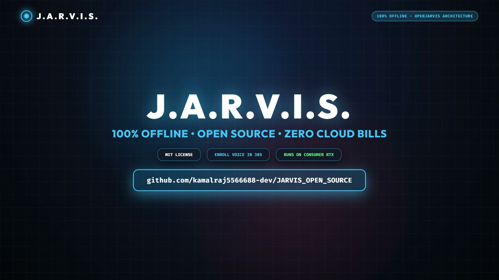

# J.A.R.V.I.S. — Open Source Offline Voice AI Assistant


**A 100% local, privacy-first personal desktop AI assistant inspired by Iron Man's J.A.R.V.I.S. and Stanford's OpenJarvis architecture.**

---

## 🌟 Overview

**J.A.R.V.I.S. (Offline Edition)** is an on-device personal voice assistant engineered to run entirely on your local hardware with **zero cloud dependencies** and **zero data leaks**.

It features **biometric speaker voice verification**, ensuring it responds strictly to its enrolled owner. Powered locally by **Ollama**, **Vosk**, **faster-whisper**, and a universal **Windows desktop automation suite**, J.A.R.V.I.S. monitors system telemetry, controls media, launches applications, executes safe shell commands, and retains long-term memory across reboots.

> [!NOTE]
> This is the **Offline-First Edition**. An upcoming release will introduce the hybrid online multi-modal extension for web-connected research and vision tasks.

---

## 🎬 Launch Demo & Overview Video

Watch the 35-second launch overview demonstrating 100% offline sovereignty, biometric speaker verification, and autonomous local self-learning:

https://github.com/kamalraj5566688-dev/JARVIS_OPEN_SOURCE/raw/main/brag-output/brag.mp4

[](brag-output/brag.mp4)

*Click the image or player above to watch [`brag.mp4`](brag-output/brag.mp4) with full 1080p motion and audio.*

---

## 🏛️ System Architecture

J.A.R.V.I.S. is built on the **5 core primitives** of the [OpenJarvis](https://github.com/open-jarvis/OpenJarvis) research framework:

```text
 ┌────────────────────────────────────────────────────────┐
 │                   MICROPHONE STREAM                    │
 └───────────────────────────┬────────────────────────────┘
                             │
                             ▼
 ┌────────────────────────────────────────────────────────┐
 │           1. WAKE-WORD SPOTTER (Vosk / Kaldi)          │
 │       Continuous low-power keyword recognition         │
 └───────────────────────────┬────────────────────────────┘
                             │ "Jarvis" / "Hey Jarvis"
                             ▼
 ┌────────────────────────────────────────────────────────┐
 │    2. VOICE BIOMETRIC VERIFIER (Speaker Embeddings)    │
 │       Cosine similarity against voice_profile.npy      │
 └─────────────┬────────────────────────────┬─────────────┘
               │ (Match < 0.70)             │ (Match >= 0.70)
               ▼                            ▼
      [ REJECT COMMAND ]           [ ACCEPT & CAPTURE ]
                                            │
                                            ▼
 ┌────────────────────────────────────────────────────────┐
 │       3. SPEECH-TO-TEXT (faster-whisper base.en)       │
 │            Offline PCM to text transcription           │
 └───────────────────────────┬────────────────────────────┘
                             │
                             ▼
 ┌────────────────────────────────────────────────────────┐
 │            4. LOCAL LLM BRAIN & PERSISTENT MEMORY      │
 │  Ollama (Qwen2.5 / Llama 3.2) + jarvis_memory.json     │
 └───────────────────────────┬────────────────────────────┘
                             │ Tool Calling & Reasoning
                             ▼
 ┌────────────────────────────────────────────────────────┐
 │        5. UNIVERSAL DESKTOP CONTROLLER & TTS           │
 │  OS control, telemetry, apps, pyttsx3 vocal feedback   │
 └───────────────────────────┬────────────────────────────┘
                             │
                             ▼
 ┌────────────────────────────────────────────────────────┐
 │             6. OPENJARVIS TRACE LOGGER                 │
 │       traces.jsonl -> Closed-Loop QLoRA Training       │
 └────────────────────────────────────────────────────────┘
```

---

## ✨ Key Features

- **🔐 100% Offline & Private:** No audio or queries leave your machine.
- **🎙️ Speaker Voice Biometrics:** Enrolls 3–5 samples of your voice; rejects unauthorized speakers and background chatter.
- **⚡ Instant Wake-Word Spotting:** Listens continuously in low-power idle mode for *"Jarvis"* or *"Hey Jarvis"*.
- **🧠 Local Small Language Model Brain:** Connects to local Ollama (`jarvis`, `qwen2.5:1.5b`, `qwen2.5:3b`, or `llama3.2:3b`) with native JSON function calling.
- **💾 OpenJarvis Persistent Memory:** Remembers your name, preferences, and facts indefinitely across machine reboots.
- **📊 Real-Time Hardware & GPU Telemetry:** Reports live CPU %, RAM %, Disk %, Battery status, and NVIDIA GPU temperature and load.
- **🖥️ Universal Desktop Automation:** Controls volume, windows, applications (VS Code, Chrome, Terminal, etc.), safe shell commands, and screenshots.
- **🎨 Draggable Floating HUD:** Translucent Tkinter status pill displaying real-time states (`IDLE`, `LISTENING`, `VERIFYING`, `THINKING`, `SPEAKING`).
- **🔁 Closed-Loop QLoRA Training Suite:** Logs interaction traces and provides a built-in fine-tuning pipeline for your local GPU.

---

## 📋 System Requirements

| Component | Minimum Specification | Recommended Specification |
| :--- | :--- | :--- |
| **Operating System** | Windows 10 / 11 (64-bit) | Windows 11 (64-bit) |
| **Processor** | Quad-core x64 CPU | 8+ core modern CPU |
| **Memory (RAM)** | 8 GB RAM | 16 GB+ RAM |
| **GPU** | Integrated Graphics | NVIDIA GPU with 4GB+ VRAM (e.g. RTX 3050+) |
| **Python** | Python 3.10 to 3.13 | Python 3.11 / 3.12 |
| **Inference Engine** | [Ollama](https://ollama.com/) | Ollama (latest) |

---

## 🚀 Installation & Quickstart

### 1. Clone the Repository

```powershell
git clone https://github.com/kamalraj5566688-dev/JARVIS_OPEN_SOURCE.git
cd JARVIS_OPEN_SOURCE
```

### 2. Create and Activate Virtual Environment

```powershell
python -m venv .venv
.\.venv\Scripts\Activate.ps1
```

### 3. Install Python Dependencies

```powershell
pip install -r requirements.txt
```

### 4. Setup Offline Speech Model

Run the automated model setup script to download and unpack the offline Vosk speech model:

```powershell
python setup_models.py
```

### 5. Enroll Your Voice Profile (One-Time Setup)

To secure Jarvis so it responds **only to your voice**, run the enrollment tool and speak 3 to 5 clear samples when prompted:

```powershell
python enroll_voice.py
```

> This creates your encrypted local biometric profile: `voice_profile.npy`.

### 6. Compile the J.A.R.V.I.S. Ollama Model

Ensure the [Ollama application](https://ollama.com/) is running in your background/system tray, then compile the custom model:

```powershell
ollama create jarvis -f jarvis.modelfile
```

---

## 🎮 Running J.A.R.V.I.S

Launch the assistant:

```powershell
python main.py
```

1. Look for the floating HUD overlay pill showing `IDLE`.
2. Say: **"Jarvis"** or **"Hey Jarvis"**.
3. Jarvis authenticates your voice biometrics and replies: *"At your service, sir."*
4. Give your voice instruction!

---

## 🗣️ Voice Commands Examples

| Voice Command | Action Executed |
| :--- | :--- |
| *"Jarvis, give me a system briefing."* | Reports time, CPU %, RAM %, Battery %, and GPU telemetry. |
| *"Launch VS Code."* | Opens Visual Studio Code. |
| *"Open Terminal."* | Opens Windows Terminal / PowerShell. |
| *"What is our battery level?"* | Reports battery charge percentage and power state. |
| *"Turn up the volume."* | Increases master sound output. |
| *"Mute the audio."* | Toggles audio mute. |
| *"Minimize all windows."* | Shows desktop. |
| *"Lock the workstation."* | Locks Windows workstation. |
| *"Jarvis, remember that my project is in D drive."* | Stores persistent fact into `jarvis_memory.json`. |
| *"Activate coding mode."* | Opens VS Code, Terminal, and GitHub simultaneously. |
| *"Take a screenshot."* | Captures desktop screenshot to your Desktop folder. |

---

## 🔬 The OpenJarvis Learning & Training Loop

J.A.R.V.I.S. logs every spoken command, transcription, and tool execution into `traces.jsonl`. You can continuously train and adapt your model:

1. **Compile your usage traces into an SFT dataset:**

   ```powershell
   python train_jarvis.py --generate
   ```

2. **Fine-tune the QLoRA adapter on your GPU:**

   ```powershell
   python train_jarvis.py --train
   ```

3. **Deploy the updated model to Ollama:**

   ```powershell
   python train_jarvis.py --deploy
   ```

---

## 📁 Repository Structure

```text
JARVIS_OPEN_SOURCE/
├── main.py                     # Central orchestrator loop (wake, VAD, verify, LLM, TTS)
├── jarvis_brain.py             # Core Cognitive Engine, dynamic system prompt & fast reflex fallback
├── actions.py                  # Universal desktop controller, hardware telemetry & offline gates
├── audio_io.py                 # Text-To-Speech (pyttsx3) & Speech-To-Text (faster-whisper)
├── speaker_verifier.py         # Resemblyzer acoustic voice biometrics engine
├── enroll_voice.py             # CLI tool to record owner voice profile
├── jarvis_memory.py            # OpenJarvis atomic persistent long-term memory engine
├── trace_logger.py             # OpenJarvis interaction trace collector
├── auto_trainer.py             # Autonomous continuous learning & background fine-tuning daemon
├── train_jarvis.py             # SFT dataset compiler & QLoRA fine-tuning pipeline
├── jarvis.modelfile            # Ollama definition for J.A.R.V.I.S. persona
├── overlay.py                  # Tkinter floating HUD status pill
├── test_offline_suite.py       # Comprehensive 33-test automated offline verification suite
├── setup_models.py             # Automated offline Vosk model downloader
├── requirements.txt            # Core runtime dependencies
├── requirements-training.txt   # Optional GPU fine-tuning dependencies
├── .env.example                # Configuration template
├── LICENSE                     # MIT License
└── README.md                   # Project documentation
```

---

## 🗺️ Roadmap

- [x] 100% Offline Core (Vosk + Whisper + Ollama)
- [x] Biometric Voice Authentication (Owner-only execution)
- [x] OpenJarvis Persistent Memory & Trace Logging
- [x] Hardware & NVIDIA GPU Sensor Telemetry
- [x] Closed-Loop QLoRA Fine-Tuning Pipeline
- [ ] Online Hybrid Mode (DuckDuckGo Live Search, Real-Time News API)
- [ ] Multi-Modal Vision (Camera screenshot OCR & visual reasoning via LLaVA)
- [ ] Mobile companion sync (Local WebSocket bridge)

---

## 📄 License

This project is open-source under the [MIT License](LICENSE).

---

## 👤 Author

- **Author:** Kamal Raj
- **GitHub:** [@kamalraj5566688-dev](https://github.com/kamalraj5566688-dev)
- **Repository:** [JARVIS_OPEN_SOURCE](https://github.com/kamalraj5566688-dev/JARVIS_OPEN_SOURCE)
